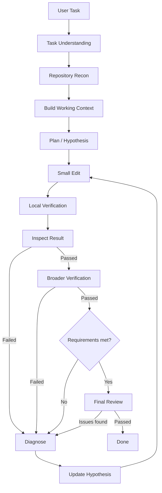

# Coding Agent 工作流

运行时维护独立于聊天历史的 `CodingWorkflow`。以下阶段通过 `workflow_updated` 事件显示在会话中，并随检查点保存：

## 操作与门槛

- `update_workflow understand` 保存任务意图和验收条件。后续修复不能删减验收条件。
- `read_file`、`search_text` 等工具提供可引用的观察 ID；`plan` 保存工作上下文、小步骤、原因假设及证据 ID。写操作和通用终端操作必须先经过这一门槛，仍遵守原有计划和工具授权。
- 优先使用 `apply_patch`。一次工具批次发生潜在修改后，模型暂停，运行时先执行局部验证，再执行扩大验证。验证命令按配置顺序运行，失败立即停止后续命令。
- Profile 的验证项可以设置 `stage: local | broader`；旧配置默认归入 local。Agent 也可在 plan 中提出本次任务的 verification 命令，由运行时授权后执行。新增检查可以追加，不能在修复中移除已有检查。
- 失败进入 Diagnose，必须使用 `diagnose` 记录不同于上一轮的假设。重复失败依次要求检查局部证据、重读周边和扩大搜索、重新审视架构假设。
- 每次潜在修改递增 revision，局部验证、扩大验证、diff、需求证据和评审的旧版本结果全部失效。
- 验证通过后读取完整 `git_diff`，包含未暂存、已暂存和新增文件。截断或失败的 diff 不满足完成门槛。
- `requirements` 为每个验收条件提供证据；`review` 记录修改范围、回归和边界条件检查。二者报告不通过时返回诊断。
- Done 由运行时决定：当前版本的验证、diff、需求证据和评审都满足，且没有待诊断失败。模型单独输出“完成了”不能完成修改任务。

## 上下文、恢复和限制

工作记忆包含目标、验收条件、文件、有限数量的假设与工具观察、当前修改版本和验证版本。每轮重新注入，压缩聊天记录不会丢失这些结构化状态。终端输出向模型提供有界摘要，原始执行结果保留在事件日志；验证日志单项存储上限为 64,000 字符。

恢复运行保留任务和假设，但使修改任务的验证与评审失效。有未确定是否执行完成的操作时，必须先检查状态并诊断，不自动重放该操作。

纯只读回答可跳过修改和代码验证阶段。修改任务至少需要一个必需的局部验证项；没有配置扩大验证时会明确记录“不执行扩大验证”，不会声称跑过完整测试。测试、需求证据和模型评审能提高可靠性，但不能机械证明所有业务语义正确。预算、权限或完整 diff 不足时保持 Review，不伪装为 Done。未发起收费模型请求；测试使用隔离模型回放及真实桌面渲染器。