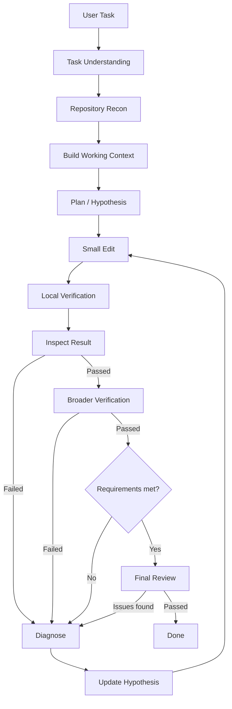

# Coding Agent 工作流

运行时维护独立于聊天历史的 `CodingWorkflow`。以下阶段通过 `workflow_updated` 事件显示在会话中，并随检查点保存：

## 操作与门槛

- `update_workflow understand` 保存任务意图和验收条件。后续修复不能删减验收条件。
- `read_file`、`search_text` 等工具提供可引用的观察 ID；`plan` 保存工作上下文、小步骤、原因假设及证据 ID。写操作和通用终端操作必须先经过这一门槛，仍遵守原有计划和工具授权。
- 优先使用 `apply_patch`。一次工具批次发生潜在修改后，模型暂停，运行时先执行局部验证，再执行扩大验证。验证命令按配置顺序运行，失败立即停止后续命令。
- Profile 的验证项可以设置 `stage: local | broader`；旧配置默认归入 local。Agent 也可在 plan 中提出本次任务的 verification 命令，由运行时授权后执行。新增检查可以追加，不能在修复中移除已有检查。
- 失败进入 Diagnose，必须使用 `diagnose` 记录不同于上一轮的假设。重复失败依次要求检查局部证据、重读周边和扩大搜索、重新审视架构假设。
- 每次潜在修改递增 revision，局部验证、扩大验证、diff、需求证据和评审的旧版本结果全部失效。
- 验证通过后读取完整 `git_diff`，包含未暂存、已暂存和新增文件。截断或失败的 diff 不满足完成门槛。
- `requirements` 为每个验收条件提供证据；`review` 记录修改范围、回归和边界条件检查。二者报告不通过时返回诊断。
- Done 由运行时决定：当前版本的验证、diff、需求证据和评审都满足，且没有待诊断失败。模型单独输出“完成了”不能完成修改任务。

## 上下文、恢复和限制

工作记忆包含目标、验收条件、文件、有限数量的假设与工具观察、当前修改版本和验证版本。每轮重新注入，压缩聊天记录不会丢失这些结构化状态。终端输出向模型提供有界摘要，原始执行结果保留在事件日志；验证日志单项存储上限为 64,000 字符。

恢复运行保留任务和假设，但为所有任务（包括 analysis）生成新的 epoch，并使验证、diff、需求证据和评审失效。旧观察仅供历史参考，不能充当新轮次的验收证据。有未确定是否执行完成的操作时，必须先检查状态并诊断，不自动重放该操作。

纯只读回答可跳过修改和代码验证阶段。修改任务至少需要一个必需的局部验证项；扩大验证的 optional 策略在未配置时记录 skipped 和原因；required 策略缺配置时阻止完成；disabled 策略不执行扩大验证并记录原因。skipped 的 passed 字段为 false，也不会写入通过版本戳。测试、需求证据和模型评审能提高可靠性，但不能机械证明所有业务语义正确。预算、权限或完整 diff 不足时保持 Review，不伪装为 Done。未发起收费模型请求；测试使用隔离模型回放及真实桌面渲染器。
## v1.2.7 证据与失败恢复

每个观察记录运行时生成的 sequence、epoch、revision、failureId、摘要及 digest。诊断必须至少引用当前失败记录或该失败之后的观察；旧观察可作为补充，不能单独满足门槛。恢复前的观察不算当前证据。观察摘要有长度上限，事件日志用于回查工具原始结果。

累计 failures 用于统计；升级策略按同一未解决故障链计数。运行时使用失败来源和规范化错误摘要构建 fingerprint，相同来源检查成功后关闭对应链，新故障从一次开始。修改 cause 不会重置计数。故障归类依赖错误文本，不能机械判断两个不同报错是否具有同一根因。

| 当前故障重复次数 | diagnose 必需证据 |
| --- | --- |
| 1 | 本次失败或之后的新观察，以及更新后的 cause |
| 2 | 以上要求，加失败后成功的仓库读取或搜索 |
| ≥3 | 以上要求，加扩展搜索、至少两个不同替代假设和实验记录；实验须引用失败后实际取得的观察 |

实验记录包含 question、expectedResults、observationIds。运行时检查记录结构、引用和时序；假设是否合理、实验是否足以区分根因仍由模型评判。诊断后允许继续读取代码，不强制立即写文件。理解任务前也允许只读工具，其活动单独展示，不提前将正式阶段改为 Repository Recon。

验收条件有稳定 requirementId。每条 requirements 证据须包含 summary、observationIds、verificationIds、diffObservationId，并引用当前 epoch/revision 的成功、完整观察和实际通过的验证运行。虚构 ID、失败或跳过的验证、旧版本证据均不能用于验收。Final Review 必须引用当前完整 diff。界面分别显示待验证、通过、失败、已跳过，以及总失败数与当前故障重复次数。

## 可选独立只读评审

Profile → 验证矩阵可设置扩大验证策略、0–5 次修复上限和独立只读评审。旧配置默认 optional + standard（不额外请求独立评审），修复上限仍默认 2。

选择 risk_based 后，敏感路径（auth/security/migration/schema）、超过三个修改文件、超过 200 行的补丁、破坏性操作或修改范围不明的操作（含无法识别路径的补丁），会触发额外评审。主流程满足验收和 diff 门槛后，运行时使用独立上下文向当前路由模型提供需求、由运行时解析的观察原文和验证命令结果、验证状态及完整 diff。缺少引用的原始记录时保持 Review。该评审无工具，输入均标记为不可信数据；不是额外授权来源。

独立评审计入轮次、token、费用和总时限；调用前检查预计费用和上下文容量。返回不通过时进入诊断，返回工具调用、非法结果、超时或预算不足时保持 Review。评审通过也只对当前 epoch/revision 生效。风险标记是保守启发式，独立评审仍是模型判断，并不构成业务语义的机械证明。
