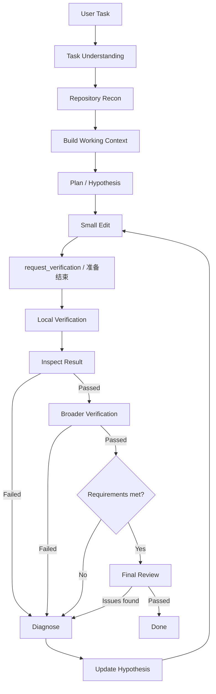

# Coding Agent 工作流

## 当前默认：分步实施与验证

新运行默认冻结为 `workflowVersion: 3`，工作流检查点为 `schemaVersion: 4`。`SequentialWorkflow` 复用轻量工具、权限、预算、证据和独立评审，并为修改任务强制以下顺序：

```text
Understand Requirement → Explore Repository → Identify Architecture → Plan
    → Implement Step 1 → Verify
    → Implement Step 2 → Verify
    → … → Integration Test → Diff Review → Done
```

模型使用 `advance_workflow` 记录阶段，实际检查由 `run_verification` 执行：

| 操作 | 内容与门槛 |
| --- | --- |
| `understand` | 保存需求理解摘要和验收条目。计划建立后不能通过重新理解删减验收条件。 |
| 仓库探索 | 使用读取／搜索工具。允许提前只读探索，但架构记录必须引用理解需求后取得的当前 epoch/revision 的成功完整仓库观察。 |
| `architecture` | 记录模块职责、依赖关系和变更边界，引用真实 `evidenceIds`；虚构、失败、旧版本及截断证据不通过。 |
| `plan` | 提供有序步骤，每步包含稳定 ID、描述和至少一个验证命令；另提供至少一个集成测试命令。替换计划须说明 `reason`，保留需求并使全部步骤验证失效。 |
| `start_step` | 只能开始第一个未通过验证的步骤；先前步骤必须有当前运行 epoch 的通过记录。 |
| `run_verification stage=local` | 输入当前计划中的命令。运行时执行当前步骤和所有之前步骤的检查，以及 Profile 局部检查；全部成功后才将当前步骤标为已验证。 |
| `run_verification stage=broader` | 全部步骤通过且局部验证对应当前代码版本后，执行计划中的集成测试和 Profile 扩大检查。修改任务不能用 optional/disabled 跳过集成测试。 |
| `git_diff` + 最终报告 | 集成测试通过后重新读取完整 diff，再由独立只读评审核对需求、步骤、真实验证输出和集成覆盖。通过后才能 Done。 |
| `reopen_step` | 指定步骤及修复原因，重新打开该步骤并使后续步骤失效；修复后按顺序重新验证。 |

例如，`plan` 的输入为：

```json
{
  "action": "plan",
  "steps": [
    { "id": "service", "text": "实现服务逻辑", "verification": [{ "command": "pnpm test service.test.ts" }] },
    { "id": "caller", "text": "接入调用方", "verification": [{ "command": "pnpm test caller.test.ts" }] }
  ],
  "integration": [{ "command": "pnpm test service-integration.test.ts" }]
}
```

命令只是格式示例，必须替换为仓库真实存在且覆盖需求的测试。配置支持 `cwd`、`timeoutMs`、`stdin`。所有执行仍经过权限与预算检查，计划本身不授予权限。命令成功只证明执行成功；测试覆盖是否充分、架构结论和修改范围是否合理，仍需模型及独立评审判断。

未完成准备或未开始实施步骤时，修改工具、通用终端及 auto/change 的宿主探针不能执行。精确的只读 Git 查询和只读工具仍可用于探索。`analysis` 模式继续使用只读工具及隔离探针，不要求实施计划或集成测试；`auto` 中只读回答仍保持轻量路径，一旦声明或尝试修改即进入上述门槛。`todo` 只是辅助清单，不能推进实施步骤或伪造验证通过。

步骤状态、验证命令及记录随检查点保存，压缩上下文不丢失。恢复保留需求和计划，但清除步骤的通过状态及架构的当前有效标记；需要重新探索、核对架构，并依次重跑步骤检查。运行时不会自动重放修改。集成或独立评审失败时，重新打开相关步骤后修复；预算不足、审批拒绝及未完成验证均不能变成 Done。

桌面进度展示需求理解、架构结论、各实施步骤状态、局部验证、集成测试和独立评审。停止信息列出尚未完成的步骤。

兼容性：显式 `workflowVersion: 2` 和历史 schemaVersion 3 检查点保留轻量工作流；`workflowVersion: 1` 和更早检查点保留旧工作流。新运行在首次执行时保存有效版本，避免恢复时提示词与执行器不一致。

验证覆盖：`tests/sequential-workflow.test.ts` 检查阶段门槛、伪造／过期证据、重排、修复和恢复；`tests/sequential-engine.test.ts` 通过真实 Engine/Bridge 与模拟 provider 检查完整两步流程、累计检查、集成失败修复、拒绝审批、预算停止及验证边界暂停恢复，不调用收费模型。

## 旧版兼容流程（workflowVersion 1）

运行时维护独立于聊天历史的 `CodingWorkflow`。以下阶段通过 `workflow_updated` 事件显示在会话中，并随检查点保存：



## 操作与门槛

- `update_workflow understand` 保存任务意图和验收条件。后续修复不能删减验收条件。
- `read_file`、`search_text` 等工具提供可引用的观察 ID；`plan` 保存工作上下文、小步骤、原因假设及证据 ID。写操作和通用终端操作必须先经过这一门槛，仍遵守原有计划和工具授权。
- 优先使用 `apply_patch`。完成包含实现、测试和所需脚本的小批修改后，调用 `update_workflow request_verification`。本轮工具批次结束后，运行时先执行局部验证，再执行扩大验证。模型准备结束时也必须经过验证门槛。终端命令的权限风险不再单独触发验证；潜在副作用仍会使旧验证结果失效。验证命令按配置顺序运行，失败立即停止后续命令。
- Profile 的验证项可以设置 `stage: local | broader`；旧配置默认归入 local。Agent 也可在 plan 中提出本次任务的 verification 命令，由运行时授权后执行。新增检查可以追加，不能在修复中移除已有检查。
- 失败进入 Diagnose，必须使用 `diagnose` 记录不同于上一轮的假设。重复失败依次要求检查局部证据、重读周边和扩大搜索、重新审视架构假设。
- 每次潜在修改递增 revision，局部验证、扩大验证、diff、需求证据和评审的旧版本结果全部失效。
- 验证通过后读取完整 `git_diff`，包含未暂存、已暂存和新增文件。截断或失败的 diff 不满足完成门槛。
- `requirements` 为每个验收条件提供证据；`review` 记录修改范围、回归和边界条件检查。二者报告不通过时返回诊断。
- Done 由运行时决定：当前版本的验证、diff、需求证据和评审都满足，且没有待诊断失败。模型单独输出“完成了”不能完成修改任务。

## 上下文、恢复和限制

工作记忆包含目标、验收条件、文件、有限数量的假设与工具观察、当前修改版本和验证版本。每轮重新注入，压缩聊天记录不会丢失这些结构化状态。终端输出向模型提供有界摘要，原始执行结果保留在事件日志；验证日志单项存储上限为 64,000 字符。

恢复运行保留任务和假设，但为所有任务（包括 analysis）生成新的 epoch，并使验证、diff、需求证据和评审失效。旧观察仅供历史参考，不能充当新轮次的验收证据。有未确定是否执行完成的操作时，必须先检查状态并诊断，不自动重放该操作。

纯只读回答可跳过修改和代码验证阶段。修改任务至少需要一个必需的局部验证项；扩大验证的 optional 策略在未配置时记录 skipped 和原因；required 策略缺配置时阻止完成；disabled 策略不执行扩大验证并记录原因。skipped 的 passed 字段为 false，也不会写入通过版本戳。测试、需求证据和模型评审能提高可靠性，但不能机械证明所有业务语义正确。预算、权限或完整 diff 不足时保持 Review，不伪装为 Done。未发起收费模型请求；测试使用隔离模型回放及真实桌面渲染器。
## v1.2.7 证据与失败恢复

每个观察记录运行时生成的 sequence、epoch、revision、failureId、摘要及 digest。诊断必须至少引用当前失败记录或该失败之后的观察；旧观察可作为补充，不能单独满足门槛。恢复前的观察不算当前证据。观察摘要有长度上限，事件日志用于回查工具原始结果。

累计 failures 用于统计；升级策略按同一未解决故障链计数。运行时使用失败来源和规范化错误摘要构建 fingerprint，相同来源检查成功后关闭对应链，新故障从一次开始。修改 cause 不会重置计数。故障归类依赖错误文本，不能机械判断两个不同报错是否具有同一根因。

| 当前故障重复次数 | diagnose 必需证据 |
| --- | --- |
| 1 | 本次失败或之后的新观察，以及更新后的 cause |
| 2 | 以上要求，加失败后成功的仓库读取或搜索 |
| ≥3 | 以上要求，加扩展搜索、至少两个不同替代假设和实验记录；实验须引用失败后实际取得的观察 |

实验记录包含 question、expectedResults、observationIds。运行时检查记录结构、引用和时序；假设是否合理、实验是否足以区分根因仍由模型评判。诊断后允许继续读取代码，不强制立即写文件。理解任务前也允许只读工具，其活动单独展示，不提前将正式阶段改为 Repository Recon。

验收条件有稳定 requirementId。每条 requirements 证据须包含 summary、observationIds、verificationIds、diffObservationId，并引用当前 epoch/revision 的成功、完整观察和实际通过的验证运行。虚构 ID、失败或跳过的验证、旧版本证据均不能用于验收。Final Review 必须引用当前完整 diff。界面分别显示待验证、通过、失败、已跳过，以及总失败数与当前故障重复次数。

## 可选独立只读评审

Profile → 验证矩阵可设置扩大验证策略和独立只读评审。旧配置默认 optional + standard（不额外请求独立评审）；修复次数和工具自纠正次数均不限，界面显示实际发生的次数。

选择 risk_based 后，敏感路径（auth/security/migration/schema）、超过三个修改文件、超过 200 行的补丁、破坏性操作或修改范围不明的操作（含无法识别路径的补丁），会触发额外评审。主流程满足验收和 diff 门槛后，运行时使用独立上下文向当前路由模型提供需求、由运行时解析的观察原文和验证命令结果、验证状态及完整 diff。缺少引用的原始记录时保持 Review。该评审无工具，输入均标记为不可信数据；不是额外授权来源。

独立评审计入轮次、token、费用和总时限；调用前检查预计费用和上下文容量。返回不通过时进入诊断，返回工具调用、非法结果、超时或预算不足时保持 Review。评审通过也只对当前 epoch/revision 生效。风险标记是保守启发式，独立评审仍是模型判断，并不构成业务语义的机械证明。

## 运行预算与停止原因

新默认预算为 128 次工具调用、64 轮模型操作（包含总结与独立评审）、30 分钟、5 美元。启动时进行一次带版本标记的 Profile 迁移：default 的工具/模型预算更新为 128/64，所有 Profile 的修复和工具自纠正上限更新为 null（不限）；其他 Profile 的自定义工具/模型预算保留。迁移不会每次启动覆盖后续修改，也不会重写历史和正在运行的 RunSpec。

修复计数只记录运行时派发的失败恢复任务；正常验证、读取 diff、需求核对、评审及总结不会增加次数。计数保存在检查点中，同一 run 恢复时保留；旧检查点通过已有 repair_started 事件恢复。工具自纠正没有固定次数终止条件，但连续重复无进展的读取、工具/模型/耗时/费用预算仍可终止任务。不限修复不等于无限模型调用。

result 的可选 stop 字段保存准确原因代码、阶段、各额度已用/上限、未完成门槛及最后失败摘要。界面显示“工具 N/128 · 模型 M/64 · 修复 R 次／不限”，而不是将所有未完成任务归因于模型额度。旧 result 事件不要求新字段。额度允许时，停止前最多生成一次无工具总结；总结失败保留原因和确定性工具记录，不丢弃历史。

补丁预检仅检查 unified diff 的路径元数据。标准新建/删除文件的 /dev/null 哨兵允许通过，代码内容中的 ../ 不被当作目标路径；实际越界路径仍被预检及 git apply --check 阻止。恢复记录以助手消息结尾时，运行时补充恢复指令再继续，不盲目重放已有修改。
